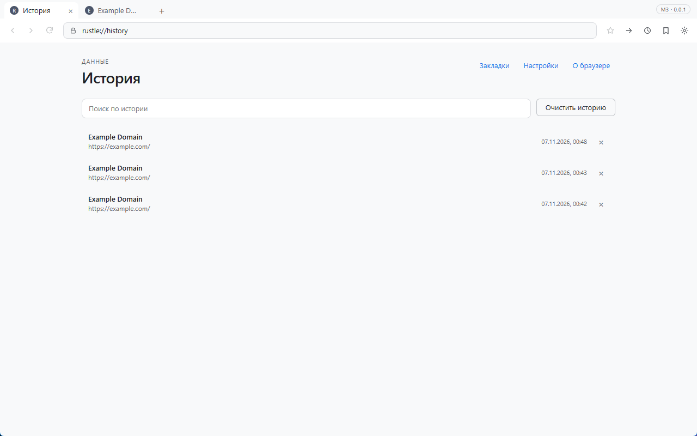

# Rustle

[](https://github.com/d1m40fficial/rustle/actions/workflows/ci.yml)

Минималистичный браузер на Rust: быстрый запуск, низкое потребление памяти, ничего лишнего.

> Статус: **M3 — данные и настройки**. История и закладки хранятся в SQLite,
> работают внутренние страницы, поиск по истории, автодополнение адресной строки,
> поисковик и светлая/тёмная тема. Менеджера загрузок пока нет.



## Документы

- [Техническое задание](docs/TZ.md) — цели, требования, архитектура, риски.
- [План реализации](docs/ROADMAP.md) — этапы, критерии приёмки, порядок работ.
- [Отчёт о возможностях движка](docs/spikes/engine-capabilities.md) — что проверено в M0.
- [Производительность](docs/perf.md) — старт, память, размер.
- [ADR](docs/adr) — принятые архитектурные решения.

## Что это

Rustle — настольный браузер для Windows, который использует системный движок WebView2
и лёгкую оболочку на Rust. Сайты открываются как в обычном браузере, а интерфейс
остаётся простым: вкладки, адресная строка, история, закладки, загрузки и настройки.

Ключевая идея — не тащить в поставку целый Chromium: на Windows WebView2 уже установлен
и обновляется системой. Это даёт небольшой установщик, быстрый старт и хорошую
совместимость с сайтами. Плата — отсутствие поддержки расширений Chrome; под них
в будущем проектируется отдельный движковый бэкенд.

## Принципы

- Мгновенный запуск и отзывчивость на слабом железе.
- Никакой телеметрии и фоновой сетевой активности.
- Минимум функций, но каждая доведена до нормального UX.
- Движок спрятан за абстракцией, ядро не зависит от UI.
- Открытый код и понятный процесс разработки на GitHub.

## Платформы

- 0.1: Windows 10/11 x64 (WebView2).
- После 0.1: macOS (WKWebView), Linux (WebKitGTK).

## Что уже работает

- Окно 1280×800 с нативным заголовком.
- HTML-оболочка: полоса вкладок, тулбар, адресная строка, назад/вперёд/обновить/стоп.
- Несколько вкладок: создание, переключение, закрытие, overflow, спиннер загрузки.
- Ctrl+T, Ctrl+W, Ctrl+Shift+T, Ctrl+Tab, Ctrl+Shift+Tab, Ctrl+1..9.
- Новая вкладка рисуется в chrome-оболочке и не создаёт WebView; WebView появляется при переходе на сайт.
- 20 пустых вкладок создаются без блокировки UI; активная вкладка прокручивается в видимую область.
- Single instance: второй запуск передаёт URL в существующее окно через loopback IPC.
- Восстановление сессии после перезапуска и после падения; история закрытых вкладок.
- `target=_blank` открывается в новой вкладке.
- Синхронизация адресной строки с реальным URL, включая `rustle://newtab`.
- Назад/вперёд с активным состоянием кнопок; Alt+←/→, F5, Ctrl+R, Ctrl+L, F12.
- SQLite-история и закладки в фоновом потоке; дедупликация посещений и поиск.
- Внутренние страницы: rustle://history, rustle://bookmarks, rustle://settings, rustle://about.
- История: поиск, удаление записи, очистка; закладки: звезда в тулбаре и удаление.
- Настройки: поисковик (DDG/Google/Яндекс/Bing), тема (системная/тёмная/светлая), старт.
- Автодополнение адресной строки по истории и закладкам.
- Поиск из адресной строки через выбранный поисковик.
- Экран ошибок DNS/сети/TLS с «Повторить» и «Назад» для активной вкладки.
- Кастомный протокол `rustle://` и строгий CSP.
- IPC между оболочкой и Rust.

## Сборка

Требования: Windows 10/11 x64, WebView2 Runtime (обычно уже установлен), Rust stable.

Вариант без прав администратора (GNU + Scoop), используется в разработке:

```powershell
scoop install rustup-gnu mingw
cargo run
```

Если `cargo` не найден в новом терминале, перезапустите терминал или добавьте в PATH:

```powershell
$env:CARGO_HOME = "$env:USERPROFILE\scoop\persist\rustup-gnu\.cargo"
$env:RUSTUP_HOME = "$env:USERPROFILE\scoop\persist\rustup-gnu\.rustup"
$env:Path = "$env:CARGO_HOME\bin;$env:USERPROFILE\scoop\apps\mingw\current\bin;$env:Path"
```

MSVC-вариант: установите Visual Studio C++ workload и `rustup default stable-x86_64-pc-windows-msvc`.

### Ограничения M3

- Нет менеджера загрузок, папок/панели закладок и импорта/экспорта.
- Фавикон — буква домена; кэша иконок нет.
- Нет очистки cookies/кэша, локализации и приватного окна.
- Перетаскивание, контекстное меню и дублирование вкладок — P1.
- Release пока запускается с консольным окном; уберём вместе с логированием.
- Запись session.json не атомарная; размер окна не сохраняется.
- Системная тема пока приравнена к тёмной.

`WebView2Loader.dll` для GNU-сборки вендорена в `assets/webview2/x64`; build.rs
копирует её рядом с exe. Для MSVC она линкуется статически.

Проверки:

```powershell
cargo fmt --all --check
cargo clippy --workspace --all-targets -- -D warnings
cargo test --workspace
```

## Лицензия

MIT.