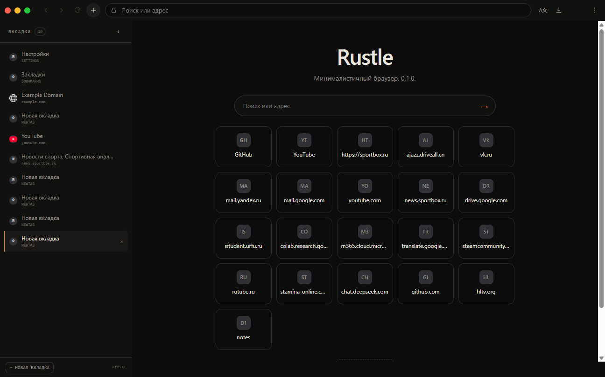

# Rustle

**Rustle** — минималистичный браузер для Windows на Rust и WebView2: вкладки и группы, закрепление, встроенный Adblock, вертикальная панель, сессии и локальные настройки.



## Возможности

- Вкладки: закрепление, перетаскивание, поиск/переключение по `Ctrl+Shift+A`.
- Группы: сворачивание, цвета, автогруппировка по домену, горячие клавиши.
- Вертикальная панель с настраиваемой шириной (72–282 px).
- Контейнеры cookie (WebView2 profiles) и контейнер новых вкладок.
- Adblock на EasyList/EasyPrivacy/RU AdList + пользовательские правила и whitelist.
- Библиотека сессий с превью, экспорт/импорт настроек и групп.
- PDF-экспорт и скриншот только области страницы.
- Менеджер загрузок с паузой/продолжением.
- Светлая/тёмная тема, RU/EN-локализация.
- Постоянный эффект частиц логотипа/надписи Rustle с настройкой интенсивности.
- История, закладки-плитки на новой вкладке, приватное окно.

## Установка

1. Скачайте `Rustle-<version>-setup.exe` из [Releases](https://github.com/d1m40fficial/rustle/releases).
2. Или распакуйте portable-архив и запустите `rustle.exe` рядом с `WebView2Loader.dll`.
3. Требуется Windows 10/11 x64 и Microsoft Edge WebView2 Runtime.

## Сборка

```powershell
cargo build --release
./scripts/build-release.ps1 -Version 0.18.0
```

Нужны Rust stable, MinGW/MSVC и Inno Setup для установщика.

## Архитектура

- `crates/rustle-app` — окно, WebView2, IPC, вкладки, меню.
- `crates/rustle-storage` — SQLite (история/закладки), JSON (настройки, сессия).
- `crates/rustle-ui` — встроенные chrome/sidebar/newtab-страницы.
- `crates/rustle-core` — разбор адресной строки и общие типы.
- `crates/rustle-engine`, `rustle-platform` — точки расширения движка/платформы.

## Тесты

```powershell
cargo test --workspace
cargo clippy --workspace --all-targets -- -D warnings
./scripts/smoke-ui.ps1
```

## Ограничения

- Общая группа процессов WebView2 в Task Manager называется Microsoft Edge WebView2 — ограничение runtime.
- Автообновление не выполняется: только ручная установка новых релизов.
- Ресайз окна за края требует проверки на конкретной конфигурации Windows; см. QA.
