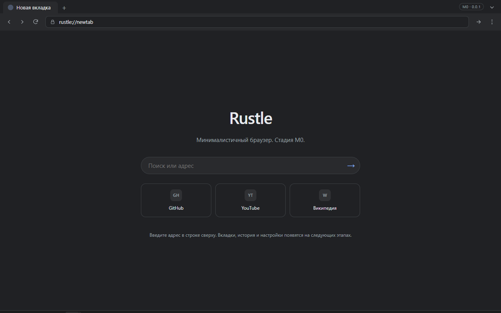

# Rustle

[](https://github.com/d1m40fficial/rustle/actions/workflows/ci.yml)

Минималистичный браузер на Rust: быстрый запуск, низкое потребление памяти, ничего лишнего.

> Статус: **M0 — каркас работает**. Есть окно, chrome WebView, content WebView,
> кастомный протокол, IPC и Ctrl+L. Вкладок, истории и настроек пока нет.



## Документы

- [Техническое задание](docs/TZ.md) — цели, требования, архитектура, риски.
- [План реализации](docs/ROADMAP.md) — этапы, критерии приёмки, порядок работ.
- [Отчёт о возможностях движка](docs/spikes/engine-capabilities.md) — что проверено в M0.
- [ADR](docs/adr) — принятые архитектурные решения.

## Что это

Rustle — настольный браузер для Windows, который использует системный движок WebView2
и лёгкую оболочку на Rust. Сайты открываются как в обычном браузере, а интерфейс
остаётся простым: вкладки, адресная строка, история, закладки, загрузки и настройки.

Ключевая идея — не тащить в поставку целый Chromium: на Windows WebView2 уже установлен
и обновляется системой. Это даёт небольшой установщик, быстрый старт и хорошую
совместимость с сайтами. Плата — отсутствие поддержки расширений Chrome; под них
в будущем проектируется отдельный движковый бэкенд.

## Принципы

- Мгновенный запуск и отзывчивость на слабом железе.
- Никакой телеметрии и фоновой сетевой активности.
- Минимум функций, но каждая доведена до нормального UX.
- Движок спрятан за абстракцией, ядро не зависит от UI.
- Открытый код и понятный процесс разработки на GitHub.

## Платформы

- 0.1: Windows 10/11 x64 (WebView2).
- После 0.1: macOS (WKWebView), Linux (WebKitGTK).

## Что уже работает

- Окно 1280×800 с нативным заголовком.
- HTML-оболочка: полоса вкладок, тулбар, адресная строка, кнопки назад/вперёд/обновить.
- Content WebView с новой вкладкой и переходом по адресу.
- Кастомный протокол `rustle://` и строгий CSP.
- IPC между оболочкой и Rust.
- Ctrl+L при фокусе в контенте: фокус в адресную строку.
- Тест перекрытия: оболочка растягивается поверх контента.

## Сборка

Требования: Windows 10/11 x64, WebView2 Runtime (обычно уже установлен), Rust stable.

Вариант без прав администратора (GNU + Scoop), используется в разработке:

```powershell
scoop install rustup-gnu mingw
cargo run
```

Если `cargo` не найден в новом терминале, перезапустите терминал или добавьте в PATH:

```powershell
$env:CARGO_HOME = "$env:USERPROFILE\scoop\persist\rustup-gnu\.cargo"
$env:RUSTUP_HOME = "$env:USERPROFILE\scoop\persist\rustup-gnu\.rustup"
$env:Path = "$env:CARGO_HOME\bin;$env:USERPROFILE\scoop\apps\mingw\current\bin;$env:Path"
```

MSVC-вариант: установите Visual Studio C++ workload и `rustup default stable-x86_64-pc-windows-msvc`.

`WebView2Loader.dll` для GNU-сборки вендорена в `assets/webview2/x64`; build.rs
копирует её рядом с exe. Для MSVC она линкуется статически.

Проверки:

```powershell
cargo fmt --all --check
cargo clippy --workspace --all-targets -- -D warnings
cargo test --workspace
```

## Лицензия

MIT.