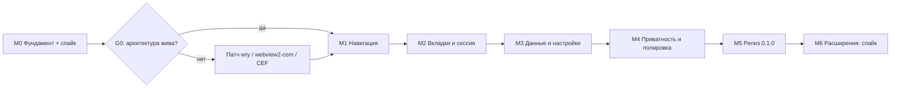

# План реализации Rustle

Документ описывает, как мы ведём проект на GitHub и в каком порядке строим браузер. Оценки — в фокусных человеко-днях одного разработчика; при неполной занятости календарный срок соответственно больше.

---

## 1. Как ведём проект

- **Репозиторий:** github.com/d1m40fficial/rustle, основная ветка `main`.
- **Модель:** trunk-based. `main` всегда собирается и проходит CI; фичи — короткие ветки, PR, squash-merge.
- **Коммиты:** Conventional Commits (`feat:`, `fix:`, `docs:`, `chore:`, `perf:`, `refactor:`).
- **Задачи:** GitHub Issues; этапы — Milestones M0–M6; метки `area:ui`, `area:engine`, `area:storage`, `priority:p0` и т.п.
- **Definition of Done задачи:** код + тесты (где применимо) + обновлённая документация + зелёный CI + ручная проверка по чек-листу.
- **Релизы:** SemVer; тег → GitHub Release с ZIP, установщиком и SHA256. CHANGELOG по Keep a Changelog.
- **Ветки защиты:** PR в `main` требует зелёного CI; для solo-разработки допускаются прямые коммиты в `main` для документации и мелких правок.
- **Шаблоны:** issue templates (bug/feature), PR template, SECURITY.md, CONTRIBUTING.md — на этапе M0.

---

## 2. Состояние среды (проверено 2026-11-06)

| Компонент | Статус | Комментарий |
|---|---|---|
| Windows | Windows 11 IoT Enterprise LTSC, 26100 | x64 |
| WebView2 Runtime | установлен, 156.0.4314.58 | используется |
| Rust | 1.99.1, host `x86_64-pc-windows-gnu` | установлен через Scoop (`rustup-gnu`) |
| MinGW-w64 | 16.2.0 | установлен через Scoop |
| Visual Studio 2026 | без C++ workload | не требуется для GNU-сборки; MSVC остаётся опцией |
| GitHub CLI | 2.103.3 | авторизован как `d1m40fficial`, scopes: repo, workflow |
| Git | 2.55 | установлен |
| Node.js | 24.19.0 | есть; для сборки не обязателен |
| Репозиторий | github.com/d1m40fficial/rustle | публичный, создан |
| Права администратора | не требуются | всё установлено в пользовательский профиль |

### 2.1 Как воспроизвести окружение

```powershell
scoop install rustup-gnu mingw gh
```

Scoop прописывает PATH и `CARGO_HOME`/`RUSTUP_HOME` в пользовательские переменные;
после установки нужен новый терминал. Для GNU-сборки обязателен `WebView2Loader.dll`;
он вендорен в `assets/webview2/x64` и копируется build.rs рядом с exe.

## 3. Этапы

### M0. Фундамент и проверка движка — 3–4 дня

Цель: убедиться, что выбранная архитектура (wry + WebView2 + HTML-оболочка) решает ключевые задачи, и подготовить репозиторий.

Задачи:

- [x] Установить Rust GNU + MinGW через Scoop, собрать пример wry.
- [x] Создать публичный репозиторий, лицензию, README, ТЗ. Защита `main` и шаблоны — после стабилизации CI.
- [x] Создать cargo workspace: `rustle-app`, `rustle-core`, `rustle-engine`, `rustle-storage`, `rustle-platform`, `rustle-ui`.
- [x] Окно 1280×800: chrome WebView, content WebView, custom protocol, IPC.
- [x] Трассировка старта: метки процесса, окна, content, chrome, chrome-ready.
- [ ] Логирование через tracing и panic hook (сейчас простые startup-метки).
- [x] CI workflow: fmt, clippy, test, release build; зелёный на windows-latest (run 42249192281).
- [x] Спайк движка и документ `docs/spikes/engine-capabilities.md`.
- [x] ADR-0001 (движок), ADR-0002 (HTML-оболочка), ADR-0003 (GNU/WebView2Loader).
- [x] Вендоринг `WebView2Loader.dll` и копирование build.rs.
- [x] Ctrl+L через AcceleratorKeyPressed; z-order chrome поверх контента проверен.

Матрица спайка (каждый пункт: работает / работает с хаком / не работает):

| Возможность | Что проверяем | Fallback |
|---|---|---|
| Несколько дочерних WebView в одном окне | создание, bounds, скрытие, удаление | отдельные окна (плохо) |
| Z-order chrome поверх контента | растягивание chrome WebView вниз | popup-окно подсказок |
| Custom protocol + ES-модули | `rustle://`, MIME, CSP, импорт модулей | локальный HTTP на 127.0.0.1 с токеном |
| IPC chrome ↔ Rust | двусторонний обмен, размеры, ошибки | — |
| Ускоренные клавиши при фокусе в контенте | Ctrl+T/W/L/F, F5, F12 через WebView2 | инъекция JS-listener, затем низкоуровневый хук |
| target=_blank / window.open | событие NewWindowRequested | перехват JS |
| Загрузки | DownloadStarting, прогресс, отмена | штатный UI WebView2 |
| Разрешения | запросы камеры/гео/уведомлений | штатный UI WebView2 |
| Масштаб | ZoomFactor per tab | JS-масштаб (плохо) |
| Поиск по странице | Find API, счётчик | JS window.find |
| Fullscreen | F11 и HTML5 | — |
| DevTools | открытие из кода | — |
| InPrivate/приватный профиль | отдельный профиль, очистка | временный каталог данных |
| Favicon | извлечение из страницы | запрос /favicon.ico |
| Очистка cookies/кэша | API профиля | удаление каталога |
| PDF и YouTube | smoke | — |
| Память базовой линии | 1 пустая вкладка | — |

### Фактические метрики M0 (debug, 2026-11-06)

| Метрика | Значение |
|---|---|
| Старт процесса → окно | 10–12 мс |
| Окно → content WebView | 152–159 мс |
| Content → chrome WebView | 198–204 мс |
| Chrome-ready (IPC) | 214–252 мс (debug), 211 мс (release) |
| Память, newtab, debug (private / WorkingSet) | 186.4 / 402.2 МБ, 9 процессов |
| Память, newtab, release (private / WorkingSet) | 172.0 / 377.7 МБ, 9 процессов |
| Память, example.com, debug (private / WorkingSet) | 190.0 / 424.9 МБ, 9 процессов |
| Ctrl+L из контента | работает, фокус в адресной строке, навигация подтверждена |
| Z-order chrome поверх content | работает при создании content → chrome |

Цель 250 МБ по private bytes выполняется (172–186 МБ на новую вкладку).
Сумма WorkingSet выше 378–425 МБ из-за общих страниц и используется только справочно.
Подробности — в `docs/spikes/engine-capabilities.md`.

**Решение G0.** Если критичные пункты (z-order, клавиатура, custom protocol, multi-webview) не решаются на wry, выбираем: патч wry / собственный хост на webview2-com (Windows) / CEF. До прохождения G0 не начинаем M1.

Критерий готовности M0:

- `cargo run --release` открывает окно, chrome UI отвечает по IPC.
- Старт до chrome ready ≤ 500 мс на машине разработчика (release).
- CI зелёный; отчёт спайка с выводами и ADR.
- Тег `v0.0.1`.

---

### M1. Одна вкладка и навигация — 3–4 дня

Цель: браузер открывает сайты и позволяет нормально ходить по ним.

Задачи:

- [x] URL-парсер: схема, домен, localhost, IPv6, поиск; 8 юнит-тестов.
- [x] Адресная строка: фокус, ввод, Enter, Esc, копирование. Alt+Enter — в M2 вместе с вкладками.
- [x] Кнопки назад/вперёд/обновить/стоп; Alt+←/→, F5, Ctrl+R.
- [x] События движка: старт, завершение, заголовок, URL, история (CanGoBack/CanGoForward).
- [x] Индикатор загрузки: спиннер на вкладке и полоса прогресса.
- [x] Ошибки DNS/сети/TLS: внутренний экран ошибки, «Повторить», «Назад».
- [ ] target=_blank пока открывается в текущей вкладке; настоящая новая вкладка — M2.
- [x] DevTools по F12 (включена feature devtools).
- [x] Стартовые метрики в `docs/perf.md`.
- [x] Favicon — буква домена; настоящий favicon — P1 после M2.

Критерий готовности:

- Открываются YouTube, Wikipedia, GitHub, Яндекс; работают ссылки, назад/вперёд, поиск из адресной строки.
- Ошибки отображаются понятно, приложение не падает.
- Старт ≤ 500 мс p50.

### Фактические метрики M1 (2026-11-06)

| Метрика | Значение |
|---|---|
| Chrome-ready, debug | 189–196 мс |
| Chrome-ready, release | 238 мс |
| Память newtab, release (private / WorkingSet) | 184.9 / 396.4 МБ, 9 процессов |
| Бинарь release | 1.09 МБ |
| Юнит-тесты | 8/8 |
| Ручные сценарии | example.com, DuckDuckGo, DNS-ошибка, retry, back/forward, Alt+←/→, Ctrl+L, восстановление после ошибки |

---

### M2. Вкладки и сессия — 4–6 дней

Цель: полноценная многовакладочная работа и восстановление после перезапуска.

Задачи:

- [x] Модель вкладок: ID, URL, заголовок, загрузка, история, ошибка, активная.
- [x] UI полосы вкладок: создание, закрытие, переключение, overflow, фавикон-буква, спиннер.
- [x] Ленивое создание WebView; скрытие/показ; корректное уничтожение.
- [x] Горячие клавиши: Ctrl+T/W/Shift+T/Tab/Shift+Tab/1..9.
- [ ] Перетаскивание, контекстное меню и дублирование вкладок — P1, не входят в текущий срез.
- [x] Сохранение/восстановление сессии, история закрытых вкладок, восстановление после падения.
- [x] Single instance и открытие ссылок из других приложений: named mutex + loopback IPC.
- [x] Проверка 100 циклов через `--stress-cycles=100`.

Критерий готовности:

- 20 вкладок: переключение ≤ 50 мс, память в бюджете, нет утечек.
- Перезапуск восстанавливает вкладки и активную позицию.
- Закрытая вкладка восстанавливается по Ctrl+Shift+T.

### Фактические метрики M2 (2026-11-06)

| Метрика | Значение |
|---|---|
| Chrome-ready, release | 298 мс |
| Память, 2 вкладки (private / WorkingSet) | 208.2 / 417.3 МБ, 9 процессов |
| Бинарь release | 1.16 МБ |
| Восстановление сессии | после kill и после graceful exit |
| Стресс 10 вкладок (старый M2) | private 508 МБ, WorkingSet 996 МБ, 19 процессов; 20-вкладочный synthetic не проходил |
| Ручные сценарии | Ctrl+T/W/Shift+T/Tab, switch, close, plus, target=_blank, ошибка в одной из вкладок, session restore |

### M2.1. Стабилизация вкладок — выполнено

- [x] Новая вкладка рисуется в chrome-оболочке; WebView не создаётся до перехода на сайт.
- [x] 20 пустых вкладок: UI не блокируется, активная вкладка автоматически прокручивается.
- [x] Single instance: named mutex, loopback IPC, передача URL и focus.
- [x] 100 циклов открытия/закрытия через `--stress-cycles=100`.
- [ ] Перетаскивание, контекстное меню и дублирование — P1.

| Метрика M2.1 | Значение |
|---|---|
| Chrome-ready, release | 283–390 мс |
| 2 вкладки, одна lazy (private / WorkingSet) | 158.4–162.3 / 343.0–353.3 МБ, 8 процессов |
| 20 пустых вкладок (debug) | 172.5 / 364.5 МБ, 8 процессов |
| 100 циклов | ok, процесс завершился чисто |
| Бинарь release | 1.21 МБ |
| Single instance | второй процесс завершается, URL открывается в первом |

### M2.1. Стабилизация вкладок — выполнено

- [x] Новая вкладка рисуется в chrome-оболочке; WebView не создаётся до перехода на сайт.
- [x] 20 пустых вкладок: UI не блокируется, активная вкладка автоматически прокручивается.
- [x] Single instance: named mutex, loopback IPC, передача URL и focus.
- [x] 100 циклов открытия/закрытия через `--stress-cycles=100`.
- [ ] Перетаскивание, контекстное меню и дублирование — P1.

| Метрика M2.1 | Значение |
|---|---|
| Chrome-ready, release | 283 мс |
| 2 вкладки, одна lazy (private / WorkingSet) | 158.4 / 343.0 МБ, 8 процессов |
| 20 пустых вкладок (debug) | 172.5 / 364.5 МБ, 8 процессов |
| 100 циклов | ok, процесс завершился чисто |
| Бинарь release | 1.21 МБ |
| Single instance | второй процесс завершается, URL открывается в первом |

---

### M3. Данные, внутренние страницы, настройки — 4–6 дней (ядро готово)

Цель: браузер помнит историю и закладки, управляет загрузками и настройками.

Задачи:

- [x] SQLite: схема, WAL, фоновый поток, 3 теста.
- [x] Запись истории; дедупликация 30 секунд; поиск, удаление, очистка.
- [x] Закладки: добавление звездой, список, удаление; папки/панель/импорт — P1.
- [x] Загрузки: DownloadStarting, путь в Downloads, прогресс, отмена, открытие файла/папки.
- [ ] Favicons: извлечение, кэш, fallback — пока буква домена.
- [x] Внутренние страницы: newtab, history, bookmarks, settings, about; downloads — нет.
- [x] Автодополнение адресной строки: история + закладки, клавиатура.
- [x] Настройки: поисковик, старт, тема; язык/загрузки/масштаб — нет.
- [x] Светлая/тёмная тема; системная = тёмная; локализации нет.
- [~] Очистка данных: история очищается; cookies/кэш — нет.

Критерий готовности:

- История и закладки сохраняются между запусками, поиск работает.
- Настройки применяются без перезапуска.
- Внутренние страницы доступны по rustle:// и работают с клавиатуры.

---

### Фактические метрики M3 (2026-11-07)

| Метрика | Значение |
|---|---|
| Chrome-ready, release | 247 мс |
| Память, history + lazy example (private / WorkingSet) | 161.8 / 351.1 МБ, 8 процессов |
| Бинарь release | 3.24 МБ (SQLite bundled) |
| Юнит-тесты | 12/12 |
| Данные | SQLite history.db, settings.json, session.json |
| Проверено | история/поиск/очистка, закладки/звезда, настройки темы, автодополнение, переход назад из внутренней страницы |

Не сделано в M3: менеджер загрузок, favicon-кэш, папки/панель закладок, импорт/экспорт,
очистка cookies/кэша, локализация.

---

### M3.1. Загрузки — выполнено частично

- [x] Перехват DownloadStarting в WebView2 и сохранение в папку «Загрузки».
- [x] Прогресс, состояние, отмена, открытие файла, показ в папке.
- [x] Страница rustle://downloads и кнопка в тулбаре.
- [ ] Список загрузок не сохраняется между запусками.
- [ ] Favicon-кэш, папки/панель закладок и импорт/экспорт — перенесены.
- [ ] Очистка cookies/кэша не сделана.

| Метрика M3.1 | Значение |
|---|---|
| Бинарь release | 3.31 МБ |
| Проверено | 2 МБ файл скачан, отображается «Готово», файл лежит в Downloads |
| Сборка/тесты | fmt, clippy, 12 тестов — ok |

---

### M4. Приватность и полировка — 4–6 дней

Цель: довести UX до состояния, когда браузером приятно пользоваться каждый день.

Задачи:

- [ ] Приватное окно (Ctrl+Shift+N), отдельный профиль, очистка следов.
- [ ] Разрешения: камера, микрофон, гео, уведомления, буфер обмена; запоминание по origin.
- [ ] Поиск по странице, масштаб, fullscreen, внешние протоколы.
- [ ] HTTPS-first, индикатор безопасности.
- [ ] Контекстные меню страницы (нативные), копирование ссылки, открыть в новой вкладке.
- [ ] Клавиатурная доступность, фокус, ARIA.
- [ ] Страница падения рендерера и восстановление вкладки.
- [ ] Очистка данных при выходе (опция).
- [ ] Lite-блокировка рекламы (P2, если успеваем) — только сетевой уровень.
- [ ] Полировка анимаций и состояний (≤ 120 мс).

Критерий готовности:

- Приватное окно не оставляет истории/cookies после закрытия (проверено вручную).
- Все горячие клавиши работают и в адресной строке, и на странице.
- Нет ошибок доступности уровня блокера в чек-листе.

---

### M5. Релиз 0.1.0 — 2–3 дня

Цель: публичный релиз на GitHub.

Задачи:

- [ ] Профилирование старта и памяти, устранение узких мест.
- [ ] Установщик Inno Setup (per-user), portable ZIP.
- [ ] Иконки, версия, лицензия, метаданные exe.
- [ ] Проверка WebView2 Runtime и понятное сообщение при отсутствии.
- [ ] QA на чистой Windows 11 VM.
- [ ] CHANGELOG, release notes, скриншоты, README.
- [ ] Тег v0.1.0, GitHub Release, SHA256.
- [ ] Пост-релизный smoke: скачать артефакт, установить, открыть сайт.

Критерий готовности: критерии приёмки из ТЗ выполнены, релиз опубликован.

---

### M6. Расширения Chrome — исследование, 5–10 дней (после 0.1)

Цель: понять, реально ли добавить расширения Chrome, и сколько это стоит.

Задачи:

- [ ] Выделить движковый трейт в полной мере; убрать утечки wry в ядро.
- [ ] Прототип CEF-бэкенда на Windows: окно, вкладка, навигация.
- [ ] Загрузка распакованного расширения (manifest v3), простой content script.
- [ ] Матрица покрытия chrome.* API.
- [ ] Оценка размера, старта, памяти, сложности сборки.
- [ ] ADR: go/no-go, границы совместимости, коммуникация ограничений.

Критерий: документ с решением; никаких обещаний полной совместимости с Chrome Web Store.

---

## 4. Порядок и зависимости



Итого до 0.1.0: **21–29 фокусных дней** (примерно 4–6 недель при полной занятости). Это оценка, а не обязательство: объём P1 может сдвигать срок.

---

## 5. Что нужно от вас для старта

1. **Подтвердить движок:** WebView2-first (рекомендация) или CEF сразу.
2. **Подтвердить платформы:** Windows-first (рекомендация) или сразу несколько ОС.
3. **Подтвердить репозиторий:** публичный `d1m40fficial/rustle` (рекомендация), приватный или другое имя.
4. **Установить C++ workload** в Visual Studio (нужен UAC) — либо разрешить мне запустить установщик, если сможете подтвердить UAC. Без этого Rust не соберётся.
5. **Разрешить установку Rust и GitHub CLI** (без администратора).
6. **Выбрать поисковик по умолчанию:** DuckDuckGo (рекомендация), Яндекс, Google, Bing.

После ответов я:

1. создаю репозиторий и пушу ТЗ с планом;
2. ставлю Rust и gh, скаффолжу workspace;
3. прохожу спайк M0 и показываю отчёт о возможностях движка;
4. начинаю M1 только после зелёного G0.

---

## 6. После 0.1.0 (backlog)

- Memory saver и агрессивная экономия памяти.
- Блокировка рекламы с косметическими фильтрами.
- Вертикальные вкладки, группы, split view.
- macOS и Linux (WKWebView/WebKitGTK), Flatpak/AppImage.
- Автообновление с подписью.
- Браузер по умолчанию, ассоциации протоколов.
- Импорт данных из Chrome/Edge (закладки, история).
- Расширения Chrome через CEF (если M6 даст «go»).
- Синхронизация? Только если появится запрос; по умолчанию — нет.

---

## 7. Риски расписания

- Спайк M0 может выявить блокер (клавиатура/z-order) и сдвинуть M1 на 3–5 дней.
- Установка C++ workload и первая сборка wry могут занять больше времени, чем ожидается.
- Кастомные загрузки/разрешения/поиск по странице в wry требуют COM-кода и могут съесть P1-время.
- Приватный профиль WebView2 может не поддерживаться wry — fallback на временный каталог.
- Желание добавить «ещё одну фичу» — главный риск; P0/P1 фиксируем до M5.