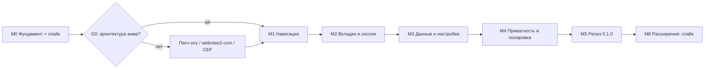

# План реализации Rustle

Документ описывает, как мы ведём проект на GitHub и в каком порядке строим браузер. Оценки — в фокусных человеко-днях одного разработчика; при неполной занятости календарный срок соответственно больше.

---

## 1. Как ведём проект

- **Репозиторий:** github.com/d1m40fficial/rustle, основная ветка `main`.
- **Модель:** trunk-based. `main` всегда собирается и проходит CI; фичи — короткие ветки, PR, squash-merge.
- **Коммиты:** Conventional Commits (`feat:`, `fix:`, `docs:`, `chore:`, `perf:`, `refactor:`).
- **Задачи:** GitHub Issues; этапы — Milestones M0–M6; метки `area:ui`, `area:engine`, `area:storage`, `priority:p0` и т.п.
- **Definition of Done задачи:** код + тесты (где применимо) + обновлённая документация + зелёный CI + ручная проверка по чек-листу.
- **Релизы:** SemVer; тег → GitHub Release с ZIP, установщиком и SHA256. CHANGELOG по Keep a Changelog.
- **Ветки защиты:** PR в `main` требует зелёного CI; для solo-разработки допускаются прямые коммиты в `main` для документации и мелких правок.
- **Шаблоны:** issue templates (bug/feature), PR template, SECURITY.md, CONTRIBUTING.md — на этапе M0.

---

## 2. Состояние среды (проверено 2026-11-06)

| Компонент | Статус | Комментарий |
|---|---|---|
| Windows | Windows 11 IoT Enterprise LTSC, 26100 | x64 |
| WebView2 Runtime | установлен, 156.0.4314.58 | можно разрабатывать |
| Git | 2.55 | установлен; глобальный user.name/email не задан |
| Node.js | 24.19.0 | есть; для сборки не обязателен |
| Visual Studio 2026 Community | установлен | **нет C++ workload и Windows SDK** |
| Rust / Cargo / rustup | **не установлены** | нужен rustup + MSVC target |
| GitHub CLI | **не установлен** | в Credential Manager есть записи `gh:github.com:d1m40fficial` |
| Права администратора | нет | установка C++ workload потребует UAC |
| Свободно на C: | ~142 ГБ | достаточно |

### 2.1 Что нужно установить

1. **Visual Studio C++ workload + Windows SDK** (нужны права администратора, ставится 20–40 минут):
   ```powershell
   & "C:\Program Files (x86)\Microsoft Visual Studio\Installer\setup.exe" modify --installPath "C:\Program Files\Microsoft Visual Studio\18\Community" --add Microsoft.VisualStudio.Workload.VCTools --includeRecommended --passive
   ```
   Проще всего: Visual Studio Installer → Modify → «Разработка классических приложений на C++» → установить. Без этого MSVC-сборка Rust не слинкуется.
2. **Rust stable (MSVC)** — без администратора:
   ```powershell
   Invoke-WebRequest https://win.rustup.rs/x86_64 -OutFile "$env:TEMP\rustup-init.exe"
   & "$env:TEMP\rustup-init.exe" -y --default-toolchain stable-x86_64-pc-windows-msvc
   ```
3. **GitHub CLI** (portable ZIP) — для создания репозитория и релизов. Можно заменить веб-интерфейсом GitHub и Git Credential Manager.
4. **Git identity** (локально в репозитории):
   ```powershell
   git config user.name "d1m40fficial"
   git config user.email "d1m40fficial@users.noreply.github.com"
   ```

---

## 3. Этапы

### M0. Фундамент и проверка движка — 3–4 дня

Цель: убедиться, что выбранная архитектура (wry + WebView2 + HTML-оболочка) решает ключевые задачи, и подготовить репозиторий.

Задачи:

- [ ] Установить Rust + MSVC, собрать пример wry.
- [ ] Создать репозиторий на GitHub, защитить `main`, добавить шаблоны, лицензию, README, ТЗ.
- [ ] Создать cargo workspace: `rustle-app`, `rustle-core`, `rustle-engine`, `rustle-storage`, `rustle-platform`, `rustle-ui`.
- [ ] Минимальное окно 1200×800 с chrome WebView (заглушка) и одной контентной вкладкой (about:blank).
- [ ] Трассировка старта: метки процесса, окна, chrome ready, первой вкладки.
- [ ] Логирование и паника.
- [ ] CI: fmt, clippy, test, release build; артефакт Windows ZIP.
- [ ] Спайк движка (см. матрицу ниже) и документ `docs/spikes/engine-capabilities.md`.
- [ ] ADR-0001 (движок), ADR-0002 (UI-оболочка), ADR-0003 (перекрытия/popup).

Матрица спайка (каждый пункт: работает / работает с хаком / не работает):

| Возможность | Что проверяем | Fallback |
|---|---|---|
| Несколько дочерних WebView в одном окне | создание, bounds, скрытие, удаление | отдельные окна (плохо) |
| Z-order chrome поверх контента | растягивание chrome WebView вниз | popup-окно подсказок |
| Custom protocol + ES-модули | `rustle://`, MIME, CSP, импорт модулей | локальный HTTP на 127.0.0.1 с токеном |
| IPC chrome ↔ Rust | двусторонний обмен, размеры, ошибки | — |
| Ускоренные клавиши при фокусе в контенте | Ctrl+T/W/L/F, F5, F12 через WebView2 | инъекция JS-listener, затем низкоуровневый хук |
| target=_blank / window.open | событие NewWindowRequested | перехват JS |
| Загрузки | DownloadStarting, прогресс, отмена | штатный UI WebView2 |
| Разрешения | запросы камеры/гео/уведомлений | штатный UI WebView2 |
| Масштаб | ZoomFactor per tab | JS-масштаб (плохо) |
| Поиск по странице | Find API, счётчик | JS window.find |
| Fullscreen | F11 и HTML5 | — |
| DevTools | открытие из кода | — |
| InPrivate/приватный профиль | отдельный профиль, очистка | временный каталог данных |
| Favicon | извлечение из страницы | запрос /favicon.ico |
| Очистка cookies/кэша | API профиля | удаление каталога |
| PDF и YouTube | smoke | — |
| Память базовой линии | 1 пустая вкладка | — |

**Решение G0.** Если критичные пункты (z-order, клавиатура, custom protocol, multi-webview) не решаются на wry, выбираем: патч wry / собственный хост на webview2-com (Windows) / CEF. До прохождения G0 не начинаем M1.

Критерий готовности M0:

- `cargo run --release` открывает окно, chrome UI отвечает по IPC.
- Старт до chrome ready ≤ 500 мс на машине разработчика (release).
- CI зелёный; отчёт спайка с выводами и ADR.
- Тег `v0.0.1`.

---

### M1. Одна вкладка и навигация — 3–4 дня

Цель: браузер открывает сайты и позволяет нормально ходить по ним.

Задачи:

- [ ] URL-парсер: схема, домен, IDN, localhost, IPv6, поиск; юнит-тесты.
- [ ] Адресная строка: фокус, ввод, Enter, Esc, Alt+Enter, копирование.
- [ ] Кнопки назад/вперёд/обновить/стоп; Alt+←/→, F5, Ctrl+R.
- [ ] События движка: старт, commit, завершение, заголовок, URL, favicon.
- [ ] Индикатор загрузки и прогресс.
- [ ] Страницы ошибок (DNS, сеть, TLS), кнопка «Повторить».
- [ ] Перехват target=_blank в новую вкладку (пока одна вкладка — замена текущей, затем M2).
- [ ] DevTools по F12 для отладки.
- [ ] Стартовые метрики в `docs/perf.md`.

Критерий готовности:

- Открываются YouTube, Wikipedia, GitHub, Яндекс; работают ссылки, назад/вперёд, поиск из адресной строки.
- Ошибки отображаются понятно, приложение не падает.
- Старт ≤ 500 мс p50.

---

### M2. Вкладки и сессия — 4–6 дней

Цель: полноценная многовакладочная работа и восстановление после перезапуска.

Задачи:

- [ ] Модель вкладок в ядре: ID, состояние, порядок, активная, закрытые.
- [ ] UI полосы вкладок: создание, закрытие, переключение, overflow, favicon, спиннер, звук.
- [ ] Ленивое создание webview; скрытие/показ; корректное уничтожение.
- [ ] Горячие клавиши вкладок: Ctrl+T/W/Shift+T/Tab/1..9.
- [ ] Перетаскивание вкладок (P1), контекстное меню (P1), дублирование (P1).
- [ ] Сохранение и восстановление сессии; восстановление после падения.
- [ ] Single instance: ссылка из другого приложения открывается в существующем окне.
- [ ] Проверка утечек: 100 циклов открытия/закрытия.

Критерий готовности:

- 20 вкладок: переключение ≤ 50 мс, память в бюджете, нет утечек.
- Перезапуск восстанавливает вкладки и активную позицию.
- Закрытая вкладка восстанавливается по Ctrl+Shift+T.

---

### M3. Данные, внутренние страницы, настройки — 4–6 дней

Цель: браузер помнит историю и закладки, управляет загрузками и настройками.

Задачи:

- [ ] SQLite: схема, миграции, WAL, фоновый поток, тесты.
- [ ] Запись истории; дедупликация; поиск и удаление.
- [ ] Закладки: CRUD, папки, панель (P1), импорт/экспорт HTML (P1).
- [ ] Загрузки: обработка, прогресс, отмена, открытие файла/папки.
- [ ] Favicons: извлечение, кэш, fallback.
- [ ] Внутренние страницы: newtab, history, bookmarks, downloads, settings, about.
- [ ] Автодополнение адресной строки: история + закладки, клавиатура, frecency.
- [ ] Настройки: поисковик, старт, тема, язык, загрузки, масштаб.
- [ ] Тёмная/светлая тема, дизайн-токены, локализация ru/en.
- [ ] Очистка данных (P1).

Критерий готовности:

- История и закладки сохраняются между запусками, поиск работает.
- Настройки применяются без перезапуска.
- Внутренние страницы доступны по rustle:// и работают с клавиатуры.

---

### M4. Приватность и полировка — 4–6 дней

Цель: довести UX до состояния, когда браузером приятно пользоваться каждый день.

Задачи:

- [ ] Приватное окно (Ctrl+Shift+N), отдельный профиль, очистка следов.
- [ ] Разрешения: камера, микрофон, гео, уведомления, буфер обмена; запоминание по origin.
- [ ] Поиск по странице, масштаб, fullscreen, внешние протоколы.
- [ ] HTTPS-first, индикатор безопасности.
- [ ] Контекстные меню страницы (нативные), копирование ссылки, открыть в новой вкладке.
- [ ] Клавиатурная доступность, фокус, ARIA.
- [ ] Страница падения рендерера и восстановление вкладки.
- [ ] Очистка данных при выходе (опция).
- [ ] Lite-блокировка рекламы (P2, если успеваем) — только сетевой уровень.
- [ ] Полировка анимаций и состояний (≤ 120 мс).

Критерий готовности:

- Приватное окно не оставляет истории/cookies после закрытия (проверено вручную).
- Все горячие клавиши работают и в адресной строке, и на странице.
- Нет ошибок доступности уровня блокера в чек-листе.

---

### M5. Релиз 0.1.0 — 2–3 дня

Цель: публичный релиз на GitHub.

Задачи:

- [ ] Профилирование старта и памяти, устранение узких мест.
- [ ] Установщик Inno Setup (per-user), portable ZIP.
- [ ] Иконки, версия, лицензия, метаданные exe.
- [ ] Проверка WebView2 Runtime и понятное сообщение при отсутствии.
- [ ] QA на чистой Windows 11 VM.
- [ ] CHANGELOG, release notes, скриншоты, README.
- [ ] Тег v0.1.0, GitHub Release, SHA256.
- [ ] Пост-релизный smoke: скачать артефакт, установить, открыть сайт.

Критерий готовности: критерии приёмки из ТЗ выполнены, релиз опубликован.

---

### M6. Расширения Chrome — исследование, 5–10 дней (после 0.1)

Цель: понять, реально ли добавить расширения Chrome, и сколько это стоит.

Задачи:

- [ ] Выделить движковый трейт в полной мере; убрать утечки wry в ядро.
- [ ] Прототип CEF-бэкенда на Windows: окно, вкладка, навигация.
- [ ] Загрузка распакованного расширения (manifest v3), простой content script.
- [ ] Матрица покрытия chrome.* API.
- [ ] Оценка размера, старта, памяти, сложности сборки.
- [ ] ADR: go/no-go, границы совместимости, коммуникация ограничений.

Критерий: документ с решением; никаких обещаний полной совместимости с Chrome Web Store.

---

## 4. Порядок и зависимости



Итого до 0.1.0: **21–29 фокусных дней** (примерно 4–6 недель при полной занятости). Это оценка, а не обязательство: объём P1 может сдвигать срок.

---

## 5. Что нужно от вас для старта

1. **Подтвердить движок:** WebView2-first (рекомендация) или CEF сразу.
2. **Подтвердить платформы:** Windows-first (рекомендация) или сразу несколько ОС.
3. **Подтвердить репозиторий:** публичный `d1m40fficial/rustle` (рекомендация), приватный или другое имя.
4. **Установить C++ workload** в Visual Studio (нужен UAC) — либо разрешить мне запустить установщик, если сможете подтвердить UAC. Без этого Rust не соберётся.
5. **Разрешить установку Rust и GitHub CLI** (без администратора).
6. **Выбрать поисковик по умолчанию:** DuckDuckGo (рекомендация), Яндекс, Google, Bing.

После ответов я:

1. создаю репозиторий и пушу ТЗ с планом;
2. ставлю Rust и gh, скаффолжу workspace;
3. прохожу спайк M0 и показываю отчёт о возможностях движка;
4. начинаю M1 только после зелёного G0.

---

## 6. После 0.1.0 (backlog)

- Memory saver и агрессивная экономия памяти.
- Блокировка рекламы с косметическими фильтрами.
- Вертикальные вкладки, группы, split view.
- macOS и Linux (WKWebView/WebKitGTK), Flatpak/AppImage.
- Автообновление с подписью.
- Браузер по умолчанию, ассоциации протоколов.
- Импорт данных из Chrome/Edge (закладки, история).
- Расширения Chrome через CEF (если M6 даст «go»).
- Синхронизация? Только если появится запрос; по умолчанию — нет.

---

## 7. Риски расписания

- Спайк M0 может выявить блокер (клавиатура/z-order) и сдвинуть M1 на 3–5 дней.
- Установка C++ workload и первая сборка wry могут занять больше времени, чем ожидается.
- Кастомные загрузки/разрешения/поиск по странице в wry требуют COM-кода и могут съесть P1-время.
- Приватный профиль WebView2 может не поддерживаться wry — fallback на временный каталог.
- Желание добавить «ещё одну фичу» — главный риск; P0/P1 фиксируем до M5.
