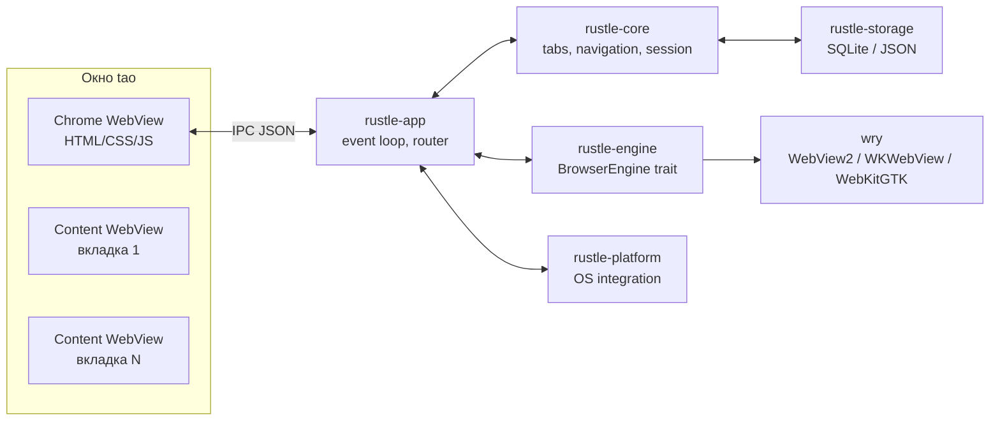

# Техническое задание: Rustle

**Версия документа:** 0.1 (черновик)
**Дата:** 6 ноября 2026
**Статус:** на согласовании
**Репозиторий:** github.com/d1m40fficial/rustle (будет создан)
**Лицензия:** MIT

---

## Кратко

Rustle — настольный веб-браузер на Rust, который использует системный веб-движок (WebView2 на Windows) и собственную минималистичную оболочку. Цель — ощущение мгновенного запуска и отзывчивости на слабом железе, аккуратный UX без лишних функций, локальные данные и отсутствие телеметрии.

Границы первой версии: Windows 10/11 x64, вкладки, адресная строка, история, закладки, загрузки, настройки, приватное окно, внутренние страницы. Расширения Chrome в 0.1 не поддерживаются: WebView2 этого не умеет. Под них проектируется отдельный движковый бэкенд и исследовательский этап после MVP.

Ключевые метрики 0.1: холодный старт до готового UI ≤ 500 мс (p50), одна пустая вкладка ≤ 250 МБ, простой CPU ≤ 1%, ноль фоновых сетевых запросов.

---

## 1. Паспорт проекта

| Параметр | Значение |
|---|---|
| Название | Rustle |
| Тип | десктопный веб-браузер |
| Платформа 0.1 | Windows 10 1809+ / Windows 11, x64 |
| Следующие платформы | macOS 12+, Linux (X11/Wayland, WebKitGTK 4.1) |
| Язык | Rust stable, edition 2024 |
| Движок 0.1 | WebView2 через wry |
| UI оболочки | HTML/CSS/JS (ES2022), без фреймворка и сборщика |
| Хранилище | SQLite (rusqlite), JSON для настроек и сессии |
| Дистрибуция | Portable ZIP + установщик Inno Setup, GitHub Releases |
| Статус | проектирование |

Имя `rustle` на crates.io занято другим проектом, поэтому публиковать крейты в crates.io не планируется. Рабочие имена крейтов — `rustle-app`, `rustle-core` и т.д.; имя приложения и репозитория — Rustle.

---

## 2. Цели и метрики успеха

### 2.1 Продуктовые цели

1. Запускаться и реагировать быстрее массовых браузеров на том же железе.
2. Давать привычный набор: вкладки, адресная строка, назад/вперёд, история, закладки, загрузки, настройки.
3. Не мешать: никаких новостных лент, аккаунтов, AI-панелей, телеметрии и фоновых сервисов.
4. Открывать современные сайты: JS, CSS, видео, PDF, веб-приложения.
5. Иметь код, который можно развивать: движок за абстракцией, ядро без UI, тесты и документация.

### 2.2 Метрики v0.1.0

| Метрика | Цель | Как измеряем |
|---|---|---|
| Холодный старт до готового chrome UI | p50 ≤ 500 мс, p95 ≤ 900 мс | трассировка старта, 10 запусков |
| Тёплый старт | p50 ≤ 300 мс | то же |
| Новая вкладка | ≤ 100 мс | событие создания |
| Переключение вкладки (уже созданной) | ≤ 50 мс | замер в приложении |
| Память, 1 пустая вкладка | ≤ 250 МБ private bytes (сумма по процессам) | скрипт, private counters |
| Память, 5 пустых вкладок | ≤ 450 МБ | скрипт |
| Память, 10 пустых вкладок | ≤ 700 МБ | скрипт |
| Простой CPU | ≤ 1% | мониторинг 5 минут |
| Установщик | ≤ 20 МБ без WebView2 | размер артефакта |
| Бинарь | ≤ 30 МБ | размер `rustle.exe` |

**Статус после M0:** старт до chrome-ready — 214–252 мс (debug), 211 мс (release).
Память по private bytes: 172–186 МБ на новую вкладку, 190 МБ на example.com (9 процессов).
Сумма WorkingSet — 378–425 МБ, но она переоценивает из-за общих страниц. Цель 250 МБ
по private выполняется; детали — в `docs/spikes/engine-capabilities.md`.

Эталонное «слабое железо» для целей: 4-ядерный ноутбук 2018–2020 годов, 8 ГБ ОЗУ, SATA SSD, Windows 11, актуальный WebView2. На машине разработчика замеры ведутся отдельно и фиксируются в `docs/perf.md`.

---

## 3. Не цели версии 0.1

- Собственный движок рендеринга.
- Синхронизация, аккаунты, облако.
- Магазин расширений Chrome и полная совместимость с расширениями.
- DRM-контент (Netflix, Spotify и подобные) — зависит от WebView2, не гарантируется.
- Мобильные версии.
- Встроенный VPN, крипто-кошелёк, AI-ассистент, новости.
- Менеджер паролей (используем возможности движка/системы).
- Группы вкладок, вертикальные вкладки, split view — после 0.1.
- Автообновление — после 0.1 (ручные релизы).
- Полная доступность уровня Chromium — базовый уровень для оболочки.

---

## 4. Принципы

1. **Скорость — функция.** Любая фича оценивается по влиянию на старт, память и отзывчивость.
2. **Локально по умолчанию.** Данные пользователя не покидают машину. Нет телеметрии и аналитики.
3. **Минимум сущностей.** Нет аккаунтов, синхронизации, лент и рекомендаций.
4. **Предсказуемость.** Клавиатура работает как в обычном браузере; поведение вкладок и адресной строки знакомо.
5. **Честные ограничения.** Если что-то не работает (DRM, расширения), это явно написано, а не спрятано.
6. **Движок — деталь.** Ядро и UI не зависят от WebView2; альтернативный бэкенд подключается за трейтом.

---

## 5. Пользователи и сценарии

Основной пользователь: технически грамотный человек, который ценит скорость, приватность и простой интерфейс; часто работает на ноутбуке среднего или слабого класса.

Сценарии:

- **S1. Быстро открыть сайт.** Запуск, ввод адреса, Enter, страница открылась; назад/вперёд работают.
- **S2. Много вкладок.** 10–20 вкладок, переключение без задержек, закрытие, восстановление закрытой.
- **S3. Вернуться к найденному.** История с поиском, автодополнение в адресной строке, закладки.
- **S4. Приватный просмотр.** Отдельное окно, после закрытия не остаётся истории и cookies.
- **S5. Скачать файл.** Прогресс, открыть файл, показать в папке.
- **S6. Настроить под себя.** Поисковик, тема, стартовая страница, масштаб.
- **S7. Слабый ноутбук.** Браузер не тормозит при наборе, не съедает всю память на пустой вкладке.

---

## 6. Функциональные требования

Обозначения приоритетов:

- **P0** — обязательно для 0.1.0.
- **P1** — желательно для 0.1.0; при нехватке времени переносится в 0.2.
- **P2** — после 0.1.

### 6.1 Окно и вкладки

| ID | Требование | Приоритет |
|---|---|---|
| FR-TAB-01 | Запуск с одним окном; URL из аргумента командной строки открывается в первой вкладке | P0 |
| FR-TAB-02 | Создание, закрытие и переключение вкладок мышью и клавиатурой; закрытие последней закрывает окно | P0 |
| FR-TAB-03 | Заголовок, фавикон, индикатор загрузки и звука обновляются в реальном времени | P0 |
| FR-TAB-04 | При переполнении вкладки не сжимаются до нечитаемого состояния: горизонтальная прокрутка или меню скрытых вкладок | P0 |
| FR-TAB-05 | Перетаскивание вкладок для изменения порядка | P1 |
| FR-TAB-06 | Восстановление закрытой вкладки (Ctrl+Shift+T), история до 25 закрытий | P1 |
| FR-TAB-07 | Контекстное меню вкладки: обновить, дублировать, закрыть, закрыть другие, закрыть справа, копировать URL | P1 |
| FR-TAB-08 | Дублирование вкладки с сохранением истории навигации (по возможности) | P1 |
| FR-TAB-09 | Отключение звука вкладки | P1 |
| FR-TAB-10 | Закрепление вкладок, группы, вертикальные вкладки | P2 |
| FR-TAB-11 | Повторный запуск приложения открывает URL в существующем окне (single instance) | P1 |

Критерий приёмки раздела: 20 вкладок открываются, переключаются и закрываются без утечек; состояние корректно восстанавливается после перезапуска.

### 6.2 Навигация и адресная строка

| ID | Требование | Приоритет |
|---|---|---|
| FR-NAV-01 | Разбор ввода: полноценный URL, домен без схемы, поисковый запрос, IDN, localhost, порт, IPv6 | P0 |
| FR-NAV-02 | Назад, вперёд, обновить, остановить; Alt+←/→, F5, Ctrl+R, Esc | P0 |
| FR-NAV-03 | Индикатор загрузки: спиннер на вкладке и тонкая полоса прогресса | P0 |
| FR-NAV-04 | target=_blank и window.open открываются в новой вкладке; всплывающие окна блокируются с уведомлением | P0 |
| FR-NAV-05 | Страницы ошибок DNS, сети, TLS, таймаута: понятный текст, кнопка «Повторить», детали по раскрытию | P0 |
| FR-NAV-06 | Автодополнение по истории и закладкам; inline-подсказка и выпадающий список с управлением клавиатурой | P0 — базовое, P1 — полное |
| FR-NAV-07 | Ctrl+L / Alt+D / F6 — фокус в адресную строку; Enter — переход; Alt+Enter — в новой вкладке; Esc — отмена | P0 |
| FR-NAV-08 | Индикатор безопасности: схема и домен; клик показывает детали соединения | P1 |
| FR-NAV-09 | Масштаб Ctrl+плюс/минус/0, запоминание масштаба для сайта | P1 |
| FR-NAV-10 | Поиск по странице Ctrl+F: подсветка, счётчик, переходы вперёд/назад | P1 |
| FR-NAV-11 | Полноэкранный режим F11 и HTML5 fullscreen | P1 |
| FR-NAV-12 | Внешние протоколы (mailto, tel и др.) передаются ОС только после подтверждения | P1 |
| FR-NAV-13 | Поддержка file:// для локальных файлов | P1 |
| FR-NAV-14 | Печать Ctrl+P | P2 |
| FR-NAV-15 | view-source | P2 |

Критерий приёмки: открываются YouTube, Wikipedia, GitHub, Яндекс, Telegram Web; навигация назад/вперёд не теряет состояние; поисковый запрос уходит в выбранный поисковик.

### 6.3 История, закладки, загрузки

| ID | Требование | Приоритет |
|---|---|---|
| FR-DATA-01 | Автоматическая запись истории при успешной навигации; приватный режим не пишет | P0 |
| FR-DATA-02 | Страница истории: поиск, группировка по дням, удаление записи, диапазона, всей истории, бесконечная прокрутка | P0 |
| FR-DATA-03 | Закладки: добавить, удалить, переименовать, папки; панель закладок | P0 — базово, P1 — панель |
| FR-DATA-04 | Импорт и экспорт закладок в HTML | P1 |
| FR-DATA-05 | Загрузки: список, прогресс, отмена, открыть файл, показать в папке, очистить список | P1 |
| FR-DATA-06 | Кэш фавиконов; fallback — буква домена | P0 |
| FR-DATA-07 | Очистка данных за период: история, кэш, cookies, загрузки | P1 |
| FR-DATA-08 | Менеджер паролей и автозаполнение — средствами движка, свой не делаем | P2 |

Загрузки в 0.1 могут использовать штатный механизм WebView2, если кастомный UI не успевает; это фиксируется в известных ограничениях.

### 6.4 Настройки и внешний вид

| ID | Требование | Приоритет |
|---|---|---|
| FR-SET-01 | Страница настроек; изменения применяются сразу, без перезапуска | P0 |
| FR-SET-02 | Поисковик: DuckDuckGo (по умолчанию), Google, Bing, Yandex, свой URL | P0 |
| FR-SET-03 | Поведение при старте: новая вкладка или восстановление сессии | P0 |
| FR-SET-04 | Тема: системная, светлая, тёмная | P0 |
| FR-SET-05 | Язык: русский, английский, авто по системе | P1 |
| FR-SET-06 | Папка загрузок | P1 |
| FR-SET-07 | Масштаб по умолчанию | P1 |
| FR-SET-08 | Компактный режим (объединённая строка вкладок и адреса) | P2 |
| FR-SET-09 | Предложение стать браузером по умолчанию | P2 |
| FR-SET-10 | Прокси | P2 |
| FR-SET-11 | Аппаратное ускорение (вкл/выкл) | P2 |
| FR-SET-12 | Портативный режим (данные рядом с exe) | P2 |
| FR-SET-13 | Сброс настроек | P2 |

### 6.5 Приватность и безопасность

| ID | Требование | Приоритет |
|---|---|---|
| FR-SEC-01 | Приватное окно: отдельный профиль, без истории; cookies и кэш удаляются при закрытии | P1 |
| FR-SEC-02 | Запросы разрешений (геолокация, камера, микрофон, уведомления, буфер обмена) с запоминанием по origin | P1 |
| FR-SEC-03 | HTTPS-first: по возможности апгрейд http → https | P1 |
| FR-SEC-04 | Запрет javascript: и data: в адресной строке | P0 |
| FR-SEC-05 | Ошибки сертификатов показываются, обход из UI невозможен | P0 |
| FR-SEC-06 | Нет телеметрии; нет фоновых сетевых запросов, кроме favicon посещённых сайтов | P0 |
| FR-SEC-07 | Подтверждение передачи внешних протоколов ОС | P1 |
| FR-SEC-08 | Опция очистки данных при выходе | P1 |
| FR-SEC-09 | Блокировка сторонних cookies (настройка) | P2 |
| FR-SEC-10 | Lite-блокировка рекламы и трекеров по списку хостов | P2 |
| FR-SEC-11 | DoH/собственный DNS | P2 |
| FR-SEC-12 | Внутренние страницы: строгий CSP, только локальные ассеты, IPC только с origin rustle:// | P0 |
| FR-SEC-13 | Изоляция сайтов — силами движка; не отключать sandbox и site isolation | P0 |

### 6.6 Внутренние страницы

| ID | Требование | Приоритет |
|---|---|---|
| FR-INT-01 | rustle://newtab, rustle://history, rustle://bookmarks, rustle://downloads, rustle://settings, rustle://about | P0 |
| FR-INT-02 | Единая дизайн-система, тёмная тема, клавиатурная доступность | P0 |
| FR-INT-03 | Никаких внешних ресурсов; строгий CSP | P0 |
| FR-INT-04 | Навигация назад/вперёд между внутренними и внешними страницами | P0 |
| FR-INT-05 | Поиск по истории с клавиатуры, горячие клавиши | P1 |
| FR-INT-06 | Новая вкладка: поиск, топ-сайты, без новостей и рекламы | P1 |

### 6.7 Расширения Chrome (после 0.1)

| ID | Требование | Приоритет |
|---|---|---|
| FR-EXT-01 | Загрузка распакованного расширения Chrome (manifest v3) через Chromium-бэкенд | P2 |
| FR-EXT-02 | Матрица совместимости API; установка из Chrome Web Store на старте не поддерживается | P2 |
| FR-EXT-03 | UI разрешений расширений, изоляция и понятные ограничения | P2 |

**Ключевое ограничение.** WebView2 не поддерживает расширения Chrome. Для их поддержки нужен альтернативный Chromium-хост (например, CEF) или собственный хост WebView2 с неполным набором API. Полная совместимость с Chrome Web Store не гарантируется. Решение принимается по итогам исследовательского этапа M6, а не обещается заранее.

---

## 7. Нефункциональные требования

### 7.1 Производительность

Бюджет старта:

| Фаза | Бюджет |
|---|---|
| Старт процесса → создано окно | ≤ 100 мс |
| Окно → первый кадр chrome UI | ≤ 250 мс |
| Chrome UI готов (IPC ready) | ≤ 400 мс |
| Создана первая вкладка | ≤ 450 мс |
| Холодный старт целиком | p50 ≤ 500 мс, p95 ≤ 900 мс |
| Тёплый старт | p50 ≤ 300 мс |

Правила:

- На UI-потоке нет синхронного диска и сети.
- Ни одна операция не блокирует UI дольше 16 мс.
- История и БД открываются в фоновом потоке; сессия читается из маленького JSON.
- Восстановленные вкладки создаются лениво: только активная.
- Анимации — не более 120 мс, без тяжёлых эффектов и размытий.

### 7.2 Память

- 1 пустая вкладка: ≤ 250 МБ суммарно по процессам.
- 5 пустых вкладок: ≤ 450 МБ.
- 10 пустых вкладок: ≤ 700 МБ.
- JS-heap оболочки: ≤ 20 МБ.
- После 100 циклов открытия/закрытия вкладок прирост RSS ≤ 50 МБ после сборки мусора.
- Memory saver (выгрузка фоновых вкладок) — P2.

### 7.3 Размер и поставка

- Бинарь ≤ 30 МБ.
- Установщик ≤ 20 МБ без WebView2 Runtime.
- Ассеты UI ≤ 500 КБ, без веб-шрифтов и иконных шрифтов.

### 7.4 Надёжность

- Восстановление сессии после аварийного завершения.
- SQLite в режиме WAL; запись настроек и сессии атомарная (временный файл + rename).
- Страница падения рендерера: «Страница упала», кнопка перезагрузить.
- Crash-free сессии ≥ 99% по ручному тестированию (до появления краш-репортинга).

### 7.5 Доступность

- Все элементы оболочки доступны с клавиатуры.
- Видимый фокус, контраст текста не ниже AA.
- ARIA-атрибуты для вкладок, тулбара, диалогов.
- Уважение prefers-reduced-motion.
- Базовая совместимость со скринридерами для оболочки; контент — средствами движка.

### 7.6 Локализация

- Русский и английский; строки вынесены в JSON, нет жёстко зашитых подписей.
- Даты и числа через Intl; время — локальное.
- Автоопределение языка системы, fallback — английский.
- RTL — P2.

### 7.7 Приватность

- Нет телеметрии, аналитики, аккаунтов и облака.
- Нет сетевых запросов при простое.
- Нет удалённых подсказок в адресной строке по умолчанию.
- Приватное окно не оставляет следов после закрытия.
- Логи не содержат URL и заголовков страниц на уровне info.

### 7.8 Безопасность

- CSP для всех внутренних страниц; запрет remote script.
- IPC: белый список команд, проверка origin, лимит размера сообщения.
- Запрет навигации на javascript: и data: сверху.
- Никаких `--disable-web-security` и удалённой отладки в релизе.
- Аудит зависимостей (cargo-audit) в CI.
- Подписанные релизы — после 0.1; до этого контрольные суммы.
- Регулярное обновление зависимостей.

### 7.9 Совместимость сайтов

Целевой smoke-набор: YouTube, Wikipedia, GitHub, Яндекс, Google, Telegram Web, Figma (просмотр), Google Docs (базово), интернет-магазины с оплатой (проверять вручную). PDF — встроенный просмотрщик WebView2.

Ограничения, которые фиксируем явно:

- DRM (Netflix и т.п.) может не работать.
- Расширения Chrome не поддерживаются в 0.1.
- Некоторые корпоративные сайты требуют Edge/Chrome-специфичных API.

User-Agent: оставляем стандартный WebView2/Edge, чтобы не ломать сайты; версия Rustle показывается на странице about.

### 7.10 Сопровождаемость

- `cargo fmt` и `cargo clippy -D warnings` без исключений.
- Юнит-тесты для ядра и хранилища.
- `unsafe` только с обоснованием и комментарием.
- Зависимости — по одной причине на крейт; новые обсуждаются.
- Документация архитектурных решений в `docs/adr`.

---

## 8. Архитектура

### 8.1 Обзор



Приложение однопроцессное с точки зрения нашей логики; процессы рендерера создаёт и изолирует WebView2. UI-поток владеет окном и webview; фоновые потоки — хранилище и сеть/иконки.

### 8.2 Выбор движка

| Критерий | WebView2 + wry | CEF | Servo/Verso |
|---|---|---|---|
| Размер поставки | ~0 МБ, runtime уже в системе | +150–250 МБ | +20–40 МБ |
| Старт | 300–600 мс | 800–1500 мс | быстрый |
| Совместимость сайтов | отличная | отличная | низкая, ломаются современные сайты |
| Расширения Chrome | нет | частично, распакованные, подмножество API | нет |
| Сложность интеграции | низкая | высокая (CMake, версии, процессы) | высокая |
| Лицензия | бесплатный проприетарный runtime | BSD | MPL-2.0 |
| Вывод | **база для 0.1** | кандидат для расширений после MVP | не подходит для «как обычный браузер» |

**Решение ADR-0001:** 0.1 строится на wry + WebView2; движок скрыт за трейтом; CEF рассматривается как отдельный бэкенд для расширений после MVP. Electron не рассматриваем из-за размера и Node в рантайме; Qt WebEngine — из-за лицензии и веса.

### 8.3 Компоненты

| Крейт | Ответственность |
|---|---|
| rustle-app | бинарь, event loop, окно, жизненный цикл webview, IPC-роутер, горячие клавиши, старт |
| rustle-core | чистая модель: вкладки, навигация, сессия, команды, события, без UI |
| rustle-engine | трейт BrowserEngine, нормализованные события, реализация wry, платформенные хаки |
| rustle-storage | SQLite (история, закладки, загрузки, favicons, permissions), настройки, сессия |
| rustle-platform | single instance, тема ОС, файловые диалоги, внешние протоколы, обновления (позже) |
| rustle-ui | встроенные HTML/CSS/JS оболочки и внутренних страниц |

Зависимости направлены внутрь: app → core/engine/storage/platform; core не знает про wry.

### 8.4 Потоки и IPC

- **UI-поток:** tao event loop, создание/удаление webview, изменение bounds, реакция на события движка. Всё, что трогает webview, — только здесь.
- **Storage-поток:** одно соединение rusqlite, команды через канал, ответы через oneshot-канал. Никаких блокировок UI.
- **Сеть/иконки:** отдельный поток для загрузки favicon и небольших сетевых задач; ограничение размера и таймауты.
- **Таймеры:** debounce сохранения сессии, автосохранение раз в 30 секунд и при изменении вкладок.

Никакого Tokio-рантайма в UI не заводим: браузеру на этом этапе хватает потоков и каналов.

IPC между chrome UI и Rust:

```json
{"v":1,"id":42,"type":"nav.go","payload":{"url":"https://example.com"}}
{"v":1,"id":42,"ok":true,"payload":{"accepted":true}}
{"v":1,"type":"event.tabs.updated","payload":{"tabs":[]}}
```

Правила: версия протокола, белый список типов, лимит 64 КБ, проверка origin для внутренних страниц, никаких произвольных команд из контента.

### 8.5 Chrome UI и перекрытия

Оболочка — отдельный WebView высотой 78 px (34 px полоса вкладок + 44 px тулбар), загружающий `rustle://chrome/`. Контент — дочерние WebView вкладок ниже.

Адресная строка с выпадающим списком подсказок требует области ниже тулбара. Решение: при открытии списка chrome WebView временно растягивается вниз (например, до 360 px) и рисует панель подсказок; контент остаётся под ним. При закрытии высота возвращается к 78 px. Это требует контроля z-order дочерних окон. В M0 проверено: если создавать content WebView первым, а chrome вторым, chrome перекрывает контент при растягивании до 360 px. Fallback: отдельное borderless-окно-попап с webview.

Контекстные меню вкладок и страницы — нативные меню ОС (muda/win32), чтобы не зависеть от перекрытий. Поиск по странице — панель в chrome WebView с временным увеличением высоты на 44 px.

Альтернатива HTML-оболочке — native/egui. Она экономит ~40–60 МБ, но проигрывает по вводу (IME), доступности и скорости разработки; к тому же проблема airspace с дочерними webview остаётся. Решение ADR-0002: HTML-оболочка; пересмотреть после замеров M1, если память не в бюджете.

### 8.6 Жизненный цикл вкладок и webview

- Вкладка создаётся лениво: webview появляется при первом активировании.
- Неактивные webview скрываются (set_visible(false)) и не меняют bounds.
- Закрытие вкладки уничтожает webview.
- Восстановленная сессия хранит URL/заголовок; грузится только активная вкладка.
- Memory saver (после 0.1): фоновые вкладки старше N минут выгружаются, при активации перезагружаются.
- Каждая вкладка получает уникальный ID; события движка маршрутизируются по ID, а не по URL.

### 8.7 Ввод, фокус, горячие клавиши

Клавиатура — главный риск гибридной архитектуры: когда фокус в контентном webview, родительское окно не получает нажатия. Нужен перехват на уровне движка (WebView2 AcceleratorKeyPressed через COM) или инъекция capture-listener в страницы. В спайке M0 проверяем:

1. Доступ к `ICoreWebView2Controller4` и событию AcceleratorKeyPressed через wry/webview2-com.
2. Инъекция скрипта на старте документа как fallback.
3. Низкоуровневый хук клавиатуры — крайний fallback.

**Проверено в M0:** WebView2 отдаёт AcceleratorKeyPressed после
`with_browser_accelerator_keys(false)`. Событие приходит на key down и key up —
обрабатывать только KEY_DOWN, иначе команда выполнится дважды. Для не-US раскладок
и IME виртуальная клавиша может приходить как VK_PROCESSKEY (0xE7); надёжнее
проверять физический ScanCode. Ctrl+L из контента фокусирует адресную строку и
дальнейшая навигация работает.

Комбинации: Ctrl+T, Ctrl+W, Ctrl+Shift+T, Ctrl+Tab, Ctrl+Shift+Tab, Ctrl+1..8, Ctrl+9, Ctrl+L, Ctrl+R, Ctrl+Shift+R, Alt+Left/Right, Ctrl+F, Ctrl+±/0, F11, F12, Esc. Обработчики вызывают одни и те же команды ядра независимо от источника.

### 8.8 Хранилище

Пути:

| ОС | Данные |
|---|---|
| Windows | `%LOCALAPPDATA%\Rustle\` (settings.json, session.json, history.db, WebView2) |
| macOS | `~/Library/Application Support/Rustle` |
| Linux | `$XDG_DATA_HOME/rustle` |

Схема SQLite (v1):

```sql
CREATE TABLE history (
  id         INTEGER PRIMARY KEY,
  url        TEXT NOT NULL,
  title      TEXT NOT NULL DEFAULT '',
  visited_at INTEGER NOT NULL
);
CREATE INDEX idx_history_visited ON history(visited_at DESC);
CREATE INDEX idx_history_url ON history(url);

CREATE TABLE bookmarks (
  id         INTEGER PRIMARY KEY,
  parent_id  INTEGER REFERENCES bookmarks(id) ON DELETE CASCADE,
  url        TEXT,
  title      TEXT NOT NULL,
  position   INTEGER NOT NULL DEFAULT 0,
  created_at INTEGER NOT NULL
);

CREATE TABLE downloads (
  id             INTEGER PRIMARY KEY,
  url            TEXT NOT NULL,
  path           TEXT,
  filename       TEXT,
  mime           TEXT,
  total_bytes    INTEGER,
  received_bytes INTEGER NOT NULL DEFAULT 0,
  state          TEXT NOT NULL,
  started_at     INTEGER NOT NULL,
  finished_at    INTEGER
);

CREATE TABLE favicons (
  origin     TEXT PRIMARY KEY,
  png        BLOB NOT NULL,
  fetched_at INTEGER NOT NULL
);

CREATE TABLE permissions (
  origin     TEXT NOT NULL,
  kind       TEXT NOT NULL,
  decision   TEXT NOT NULL,
  updated_at INTEGER NOT NULL,
  PRIMARY KEY (origin, kind)
);

CREATE TABLE meta (key TEXT PRIMARY KEY, value TEXT);
```

Версия схемы — `PRAGMA user_version`; миграции вперёд, без потери данных. WAL, foreign_keys=ON, busy_timeout.

Настройки (settings.json) и сессия (session.json) — версионированные структуры serde; запись атомарная; сессия сохраняется с debounce и при выходе. Флаг `clean_exit` позволяет предложить восстановление после падения.

### 8.9 Безопасность

- Chrome UI: только локальные ассеты, CSP `default-src 'none'; script-src 'self'; style-src 'self' 'unsafe-inline'; img-src 'self' data:; connect-src 'none'`.
- Внутренние страницы отдаются тем же протоколом; никаких внешних CDN.
- IPC обрабатывается только для chrome WebView и для webview, чей текущий URL имеет схему `rustle`; сообщения валидируются по схеме и размеру.
- Контентные страницы не получают файловых, сетевых и навигационных API, кроме обычного веба.
- Приватный профиль — отдельный каталог данных или InPrivate-профиль WebView2 (что подтвердит спайк); удаление после закрытия.
- Внешние протоколы — только после подтверждения.
- Файлы скачиваются в папку загрузок; путь санитизируется; запрет перезаписи системных файлов.
- Никаких удалённых обновлений кода в 0.1.

### 8.10 Ошибки и логи

- `tracing` + `tracing-subscriber`; уровень info по умолчанию, debug — по флагу.
- Ротация: 5 файлов по 2 МБ в `%LOCALAPPDATA%\Rustle\logs`.
- URL и заголовки не логируются на info.
- Паника приложения пишется в лог; при следующем старте — предложение восстановить сессию.
- Страницы ошибок навигации — локальный HTML, без внешних ресурсов.

### 8.11 Последовательность старта

1. Разбор аргументов (URL, `--private`, `--portable`).
2. Инициализация логов и паники.
3. Чтение settings.json (маленький файл, ≤ 50 КБ).
4. Создание окна, chrome WebView, показ окна.
5. Параллельно: открытие SQLite в фоновом потоке, чтение session.json.
6. IPC ready от chrome UI — фиксируем метку.
7. Создание активной вкладки (лениво остальные), восстановление bounds.
8. Прогрев favicon/истории — после первого кадра, не блокируя.

### 8.12 Расширяемость движка

```rust
pub trait BrowserEngine {
    fn create_tab_view(&mut self, tab: TabId, bounds: Rect) -> Result<()>;
    fn navigate(&mut self, tab: TabId, url: &Url) -> Result<()>;
    fn set_bounds(&mut self, tab: TabId, bounds: Rect) -> Result<()>;
    fn set_visible(&mut self, tab: TabId, visible: bool) -> Result<()>;
    fn close_tab_view(&mut self, tab: TabId);
    fn eval(&self, tab: TabId, script: &str);
    fn zoom(&mut self, tab: TabId, factor: f64) -> Result<()>;
    fn find(&mut self, tab: TabId, query: &str, forward: bool) -> Result<()>;
}

pub enum EngineEvent {
    NavigationStarted { tab: TabId, url: Url },
    NavigationCommitted { tab: TabId, url: Url },
    LoadFinished { tab: TabId },
    TitleChanged { tab: TabId, title: String },
    FaviconChanged { tab: TabId, icon: Option<Vec<u8>> },
    NewWindowRequested { tab: TabId, url: Url },
    DownloadRequested { tab: TabId, url: Url, suggested_name: Option<String> },
    PermissionRequested { tab: TabId, origin: String, kind: PermissionKind },
    ProcessFailed { tab: TabId, reason: String },
    FullscreenChanged { tab: TabId, fullscreen: bool },
}
```

Трейт живёт в `rustle-engine`; реализация wry может требовать main-thread-ограничений, поэтому вызовы идут через очередь событий UI-потока. CEF-бэкенд позже реализует тот же трейт (с оговорками по потокам).

---

## 9. Технологический стек

| Компонент | Выбор | Зачем |
|---|---|---|
| Язык | Rust stable, edition 2024 | безопасность, скорость, один бинарь |
| Окно/события | tao | кроссплатформенное окно, интеграция с wry |
| WebView | wry | WebView2/WKWebView/WebKitGTK за одним API |
| Платформенные хаки | webview2-com (Windows) | доступ к недостающим API WebView2 |
| БД | rusqlite (bundled) | история/закладки без внешней зависимости |
| Сериализация | serde, serde_json | настройки, сессия, IPC |
| URL | url | разбор и нормализация |
| Логи | tracing, tracing-subscriber | структурные логи |
| Ошибки | thiserror, anyhow | библиотеки/приложение |
| Каналы | crossbeam-channel | UI ↔ storage |
| Favicon | ureq (или reqwest с rustls) | небольшие загрузки без Tokio |
| Меню | muda | нативные контекстные меню |
| Каталоги | directories | пути по ОС |
| UI | HTML/CSS/JS ES2022 | быстрый UI, IME, доступность |

Не тащим: Electron, Node в рантайме, Tokio в UI, веб-фреймворки, иконные шрифты, CSS-фреймворки.

---

## 10. Сборка, CI/CD, поставка

### 10.1 Профили

- dev: opt-level 1 для зависимостей, debug symbols.
- release: opt-level 3, LTO fat, codegen-units 1, panic abort, strip symbols.
- Размер и старт проверяются на release-сборке, не на dev.

### 10.2 CI (GitHub Actions)

- Матрица: windows-latest (основная), ubuntu-24.04, macos-14.
- Шаги: fmt --check, clippy -D warnings, test, build --release, cargo-audit.
- Кэш cargo/registry.
- На Windows — артефакт portable ZIP; на релизном теге — установщик и Release.
- UI-смоук: `rustle --smoke-test` открывает локальную страницу, ждёт NavigationCompleted и выходит с кодом 0 (может быть нестабильно в CI; помечается как non-blocking до стабилизации).

### 10.3 Ветки и релизы

- Trunk-based: main всегда зелёный; фичи — короткие ветки, PR, squash.
- Conventional Commits; CHANGELOG вручную по Keep a Changelog.
- SemVer: 0.x до стабильного API; 0.1.0 — первый публичный релиз.
- Тег → сборка → GitHub Release с ZIP, установщиком, SHA256.

### 10.4 Установщик

- Inno Setup, per-user установка без администратора.
- Portable ZIP рядом с exe (`--portable` — P2).
- Проверка наличия WebView2 Runtime; если нет — ссылка на установку Microsoft.
- Иконки, версия, лицензия в installer.
- Код-подпись — после 0.1; до этого SmartScreen может предупреждать.

---

## 11. Тестирование и приёмка

### 11.1 Уровни

| Уровень | Что проверяем |
|---|---|
| Unit | URL-парсер, поисковики, frecency, сессия, настройки, миграции |
| Storage | SQLite на временном каталоге, конкурентные чтения/записи, WAL |
| Integration | команды ядра ↔ события движка на фейковом движке |
| Smoke | запуск, открытие локальной страницы, закрытие |
| Manual QA | матрица сайтов, клавиатура, темы, приватность, установка |
| Perf | 10 запусков, память, простой CPU |
| Security | чек-лист CSP/IPC/протоколов, cargo-audit |

### 11.2 Матрица ручного QA (минимум)

- Запуск на чистой Windows 11 VM без Rust/VS.
- Открытие 10 сайтов из smoke-набора, видео YouTube, PDF.
- 20 вкладок, переключение, закрытие, восстановление после kill.
- Приватное окно: проверить отсутствие истории и cookies после закрытия.
- Тёмная/светлая тема, масштаб 80–200%, fullscreen.
- Клавиатура: все горячие клавиши при фокусе в адресной строке и на странице.
- Ошибки: неверный домен, отключённая сеть, просроченный сертификат.
- Установка/удаление, portable-запуск.

### 11.3 Критерии приёмки 0.1.0

- Все P0 выполнены; P1 — по возможности, с записью в известных ограничениях.
- Метрики старта и памяти в пределах бюджета (или зафиксировано отклонение с планом).
- Нет открытых P0/P1 багов.
- CI зелёный на всех трёх ОС (сборка), релизный workflow работает.
- Установщик ставится и удаляется на чистой машине.
- Документация: README, ТЗ, ROADMAP, CHANGELOG, QA, известные ограничения.
- Приватность: нет телеметрии, нет фоновых запросов при простое.

---

## 12. Риски и меры

| Риск | Вероятность | Влияние | Мера |
|---|---|---|---|
| Нехватка API wry (zoom, find, downloads, permissions, accelerator keys) | высокая | высокое | спайк M0, доступ через webview2-com, патчи wry, fallback на JS/COM |
| Проблемы z-order при растягивании chrome WebView | средняя | высокое | спайк M0; fallback — отдельное popup-окно подсказок |
| Custom protocol и ES-модули ведут себя по-разному на ОС | средняя | среднее | спайк, fallback — локальный HTTP-сервер на 127.0.0.1 с токеном |
| Старт WebView2 не укладывается в 500 мс на слабом железе | средняя | среднее | бюджет, ленивая инициализация, замеры, честные цели |
| Память выше бюджета из-за второй WebView | средняя | среднее | замеры M1; fallback — native/egui оболочка |
| Расширения Chrome невозможны на WebView2 | высокая | высокое (для роадмапа) | честно зафиксировать; spike CEF после MVP; не обещать Web Store |
| DRM-сайты не работают | высокая | среднее | известное ограничение, проверить в M0 |
| Безопасность IPC | средняя | высокое | белый список, origin-проверка, лимиты, аудит |
| Расползание объёма | высокая | высокое | P0/P1, этапы, заморозка фич перед 0.1 |
| Linux-зависимости WebKitGTK | средняя | низкое (0.1 — Windows) | отложить, Flatpak/AppImage позже |
| macOS подпись/нотаризация | высокая | низкое (после 0.1) | отложить |

---

## 13. Открытые вопросы для согласования

| Вопрос | Рекомендация | Альтернативы |
|---|---|---|
| Движок 0.1 | WebView2 + wry, расширения — отдельный CEF-спайк после MVP | CEF сразу; прототип обоих |
| Платформы 0.1 | Windows 10/11 x64 | Windows + macOS; все три |
| Репозиторий | публичный github.com/d1m40fficial/rustle | приватный; другой аккаунт/имя |
| Лицензия | MIT | Apache-2.0; dual MIT/Apache-2.0 |
| Поисковик по умолчанию | DuckDuckGo | Яндекс; Google; Bing |
| Приватное окно в 0.1 | да, P1 | перенести в 0.2 |
| DevTools в релизе | да, по F12 | только в dev-сборках |

---

## 14. Глоссарий

- **Chrome UI** — оболочка браузера: вкладки, адресная строка, меню.
- **Content WebView** — webview, в котором открыт сайт.
- **Движок** — системный компонент рендеринга (WebView2/WKWebView/WebKitGTK).
- **Внутренняя страница** — страница Rustle по схеме `rustle://`.
- **Frecency** — ранжирование по частоте и свежести посещений.
- **Memory saver** — выгрузка фоновых вкладок для экономии памяти.
- **CEF** — Chromium Embedded Framework, альтернативный движок для будущих расширений.

---

## 15. История изменений

| Версия | Дата | Изменения |
|---|---|---|
| 0.1 | 2026-11-06 | Первый черновик ТЗ |